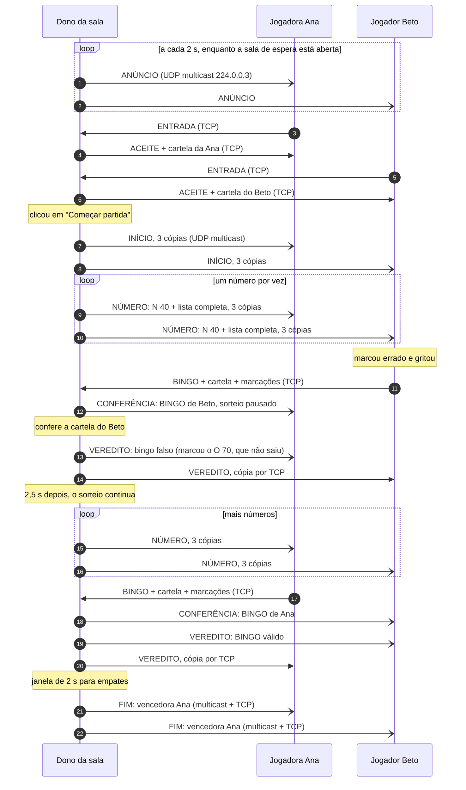
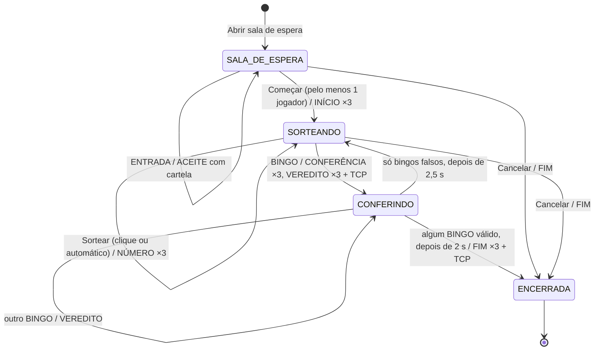

# Plugin Bingo: protocolo BINGO/1

Bingo multiplayer em rede para o Pitiupi. O **dono da sala** sorteia uma cartela para cada jogador e depois sorteia os números, que chegam a todos ao mesmo tempo por **UDP multicast**. Cada jogador marca a própria cartela clicando nos números. Quem completar grita **BINGO** por **TCP**, e o dono da sala confere a cartela: se estiver certa, declara a vitória; se não, anuncia o **bingo falso** para a sala inteira e o jogo continua.

O plugin não abre nenhum socket próprio: tudo passa pelo núcleo do Pitiupi (`MessageDispatcher`), que oferece UDP multicast, UDP unicast e TCP.

Autor: Tiago.

- [1. Como instalar e rodar](#1-como-instalar-e-rodar)
- [2. Regras do jogo](#2-regras-do-jogo)
- [3. Organização do código](#3-organização-do-código)
- [4. Visão geral do protocolo](#4-visão-geral-do-protocolo)
- [5. Formato das mensagens](#5-formato-das-mensagens)
- [6. Fluxo de uma partida](#6-fluxo-de-uma-partida)
- [7. Máquinas de estado](#7-máquinas-de-estado)
- [8. Conferência da cartela e bingo falso](#8-conferência-da-cartela-e-bingo-falso)
- [9. Empate: a janela de 2 segundos](#9-empate-a-janela-de-2-segundos)
- [10. Confiabilidade](#10-confiabilidade)
- [11. Detecção de falhas](#11-detecção-de-falhas)
- [12. Segurança e anti-trapaça](#12-segurança-e-anti-trapaça)
- [13. Temporizadores e constantes](#13-temporizadores-e-constantes)
- [14. Observando no Wireshark](#14-observando-no-wireshark)
- [15. Testes](#15-testes)
- [16. Limitações](#16-limitações)

---

## 1. Como instalar e rodar

O plugin é compilado contra o núcleo do Pitiupi ([git.alice.ufsj.edu.br/fls/pitiupi](https://git.alice.ufsj.edu.br/fls/pitiupi)) e precisa ficar dentro dele, na pasta `plugins/bingo`.

1. Baixe o Pitiupi:

```bash
git clone https://git.alice.ufsj.edu.br/fls/pitiupi.git
cd pitiupi
```

2. Copie a pasta deste plugin para `plugins/bingo` (ou clone o repositório do plugin nesse caminho).

3. Acrescente esta entrada à lista `plugins` do arquivo `plugins.registry.json`, na raiz do Pitiupi:

```json
{
  "id": "bingo",
  "dir": "plugins/bingo",
  "build": "ant",
  "jar": "dist/pitiupi.bingo.jar",
  "menuCategory": "Jogos"
}
```

4. Compile e abra (é preciso ter `java`, `ant` e `python3`):

```bash
./scripts/pitiupi.sh run --all
```

O build procura o núcleo em `../../pitiupi/dist/pitiupi.jar` (propriedade `project.pitiupi` em `nbproject/project.properties`), por isso o plugin precisa estar em `plugins/bingo`. Para compilar só o plugin, depois de compilar o núcleo (`cd pitiupi && ant jar`):

```bash
cd plugins/bingo && ant jar             # gera dist/pitiupi.bingo.jar
```

Outra opção é instalar o JAR pronto pela aba **Configurações → Instalar JAR…** do Pitiupi.

**Para jogar** (são precisos pelo menos dois computadores na mesma rede e na mesma porta; veja o arquivo `docs/rede.md` do Pitiupi):

1. Abra a aba **Bingo** na galeria de plugins.
2. **Dono da sala:** escolha o título e o que é preciso para ganhar (cartela cheia ou uma linha) e clique em **Abrir sala de espera**.
3. **Jogadores:** a partida aparece em até 2 s em **Partidas abertas na rede**. Selecione e clique em **Entrar na partida**. A cartela chega na hora.
4. O dono da sala clica em **Começar partida** e depois em **Sortear número**, ou liga o **Sorteio automático**.
5. Os jogadores clicam nos números sorteados para marcar. Quem completar clica em **BINGO!**.
6. O sorteio pausa, o dono confere a cartela, e todos veem o resultado: vitória ou bingo falso.

O painel de baixo, **Protocolo BINGO/1**, mostra cada mensagem enviada (→) e recebida (←), com o transporte usado.

---

## 2. Regras do jogo

| Regra | Como funciona |
| --- | --- |
| Cartela | 5 × 5, com as colunas B (1 a 15), I (16 a 30), N (31 a 45), G (46 a 60) e O (61 a 75). O centro é livre e já vem marcado. Cada jogador recebe uma cartela diferente, sorteada pelo dono da sala. |
| Sorteio | 75 bolas, sem repetição. O dono sorteia um número por clique ou liga o sorteio automático (a cada 2 a 30 s; padrão 5 s). |
| Marcação | O jogador clica nos números. A marcação é responsabilidade dele, como no bingo de papel: pode errar. |
| Para ganhar | **Cartela cheia** (padrão) ou **uma linha, coluna ou diagonal**, conforme o dono escolheu. |
| BINGO | O jogador grita BINGO e envia a cartela com as marcações. O sorteio pausa durante a conferência. |
| Bingo falso | Marcou um número que não saiu, ou a cartela ainda não está completa: o dono anuncia o bingo falso a todos (com o motivo) e o jogo continua. |
| Empate | Todos os BINGOs válidos que chegarem em até 2 s depois do primeiro dividem a vitória. |

---

## 3. Organização do código

```
plugins/bingo/
├── README.md                       ← este documento
├── build.xml, nbproject/           ← build Ant (mesmo esquema dos plugins do Pitiupi)
├── src/META-INF/services/pitiupi.models.Plugin   ← SPI: pitiupi.bingo.plugin.BingoPlugin
├── src/pitiupi/bingo/
│   ├── plugin/BingoPlugin.java     ← entrada do plugin; encaminha cada mensagem ao dono da sala ou ao jogador
│   ├── net/                        ← as 10 mensagens do protocolo e o enum Pattern
│   ├── control/
│   │   ├── BingoHost.java          ← máquina de estados do dono da sala (cartelas, sorteio, conferência)
│   │   ├── BingoPlayer.java        ← máquina de estados do jogador (descoberta, números, BINGO)
│   │   ├── BingoRules.java         ← regras: cartela, sorteio, conferência
│   │   ├── Dedup.java              ← descarte de cópias (senderId, seq)
│   │   ├── BingoTransport.java     ← interface de rede (permite testar sem sockets)
│   │   └── PitiupiTransport.java   ← implementação real sobre o MessageDispatcher
│   └── GUI/BingoPanel.java         ← interface Swing
└── test/pitiupi/bingo/BingoSimulation.java   ← partida simulada com perda de pacotes
```

---

## 4. Visão geral do protocolo

### Papéis

| Papel | Quem é | Responsabilidade |
| --- | --- | --- |
| **Dono da sala** | Quem clicou em *Abrir sala de espera* | Sorteia as cartelas e os números, confere os BINGOs e declara os vencedores. Não joga. |
| **Jogador** | Quem entrou na partida | Recebe a cartela, marca os números e grita BINGO. |

É uma arquitetura **P2P híbrida**: qualquer participante pode ser dono de uma sala, e a descoberta é feita por multicast, sem diretório central. Durante a partida, o dono da sala é o árbitro, como o locutor num bingo de verdade.

### Mensagens e transporte de cada uma

Os nomes em maiúsculas são os que aparecem no log da interface. Entre parênteses está a classe Java correspondente.

| Mensagem | Direção | Transporte | Por quê |
| --- | --- | --- | --- |
| `ANÚNCIO` (`AnnounceMessage`) | dono → sala | **UDP multicast**, a cada 2 s | Descoberta: o dono não sabe quem quer jogar. Um datagrama chega a todos; se um se perder, outro sai em 2 s (estado leve). |
| `ENTRADA` (`JoinMessage`) | jogador → dono | **TCP** | Pedido de entrada; precisa chegar. |
| `ACEITE` (`JoinAckMessage`) | dono → jogador | **TCP** | Aceita a entrada e **entrega a cartela**. A cartela é individual e não pode se perder. |
| `SAÍDA` (`LeaveMessage`) | jogador → dono | **TCP** | Saída voluntária. |
| `INÍCIO` (`StartMessage`) | dono → sala | **UDP multicast**, 3 cópias | Padrão de vitória e lista oficial de jogadores. |
| `NÚMERO` (`DrawMessage`) | dono → sala | **UDP multicast**, 3 cópias | **O mesmo número chega a todos no mesmo instante**, com um único envio. Leva também a lista de todos os números já sorteados. |
| `BINGO` (`ClaimMessage`) | jogador → dono | **TCP** | O pedido de vitória, com a cartela e as marcações. Não pode se perder. |
| `CONFERÊNCIA` (`CheckingMessage`) | dono → sala | **UDP multicast**, 3 cópias | Avisa a todos que alguém gritou BINGO e que o sorteio está pausado. |
| `VEREDITO` (`VerdictMessage`) | dono → sala e → quem gritou | **UDP multicast**, 3 cópias, **e TCP** para quem gritou | Resultado da conferência, com a cartela conferida. Todos veem; quem gritou recebe com garantia. |
| `FIM` (`EndMessage`) | dono → sala e → cada jogador | **UDP multicast**, 3 cópias, **e TCP** para cada jogador | Vencedores ou cancelamento. Ninguém pode ficar esperando um número que não vai mais sair. |

A presença (quem está conectado) é do **núcleo**: o sinal de presença (*heartbeat*) por UDP multicast a cada 5 s. O jogo reaproveita essa informação ([§11](#11-detecção-de-falhas)).

### Camadas

```
┌────────────────────────────────────────────────────┐
│ BINGO/1  (ANÚNCIO, NÚMERO, BINGO, VEREDITO, …)     │  aplicação (este plugin)
├────────────────────────────────────────────────────┤
│ Serialização Java  (Message.toByteArray)           │  apresentação (núcleo)
├──────────────────────────┬─────────────────────────┤
│ UDP  (1 datagrama =      │ TCP  (quadro: inteiro   │  transporte (núcleo)
│       1 mensagem)        │  de 4 bytes N + N bytes)│
├──────────────────────────┴─────────────────────────┤
│ IP  (unicast ou grupo multicast 224.0.0.3, TTL 1)  │  rede
└────────────────────────────────────────────────────┘
```

A porta é a mesma do login (por exemplo, 5000), para UDP e para TCP.

---

## 5. Formato das mensagens

Todas as mensagens estendem `BingoMessage`, que estende `pitiupi.models.Messages.Message` (`Serializable`). Cada classe tem `serialVersionUID = 1`: se um colega estiver com uma versão incompatível do plugin, a desserialização falha, em vez de gerar uma mensagem "quase certa".

### Cabeçalho comum (`BingoMessage`)

| Campo | Tipo | Significado |
| --- | --- | --- |
| `version` | int | Versão do protocolo (`1`). Mensagens de outra versão são descartadas. |
| `sessionId` | String (8 dígitos hexadecimais) | Identificador da partida, sorteado pelo dono. Separa partidas simultâneas na mesma sala. |
| `senderId` | String (UUID) | `instanceId` de quem enviou, o mesmo do sinal de presença do núcleo. |
| `senderName` | String | Nome exibido. |
| `seq` | long | Número de sequência por remetente. O par `(senderId, seq)` identifica o pacote e permite descartar duplicatas. |
| `sentAtMillis` | long | Instante do envio no relógio de quem enviou (informativo). |

### Corpo de cada mensagem

| Mensagem | Campos | Observações |
| --- | --- | --- |
| `ANÚNCIO` | `title`, `pattern`, `playerNames[]`, `open` | `open=false` avisa que a sala de espera fechou. |
| `ENTRADA` | (nenhum) | O cabeçalho já informa quem é. |
| `ACEITE` | `accepted`, `reason`, `card[25]`, `pattern` | `card`: 25 números linha por linha, com 0 no centro (casa livre). Motivos de recusa: a partida já começou ou a sala está cheia (40 jogadores). |
| `SAÍDA` | (nenhum) | |
| `INÍCIO` | `pattern`, `playerIds[]`, `playerNames[]` | |
| `NÚMERO` | `drawCount`, `number`, `drawn[]` | `drawn` traz **todos** os números já sorteados, na ordem ([§10](#10-confiabilidade)). |
| `BINGO` | `drawCountSeen`, `card[25]`, `marks[25]` | `marks[i] = true` se o jogador marcou a casa `i`. |
| `CONFERÊNCIA` | `claimantId`, `claimantName` | |
| `VEREDITO` | `claimantId`, `claimantName`, `valid`, `reason`, `card[25]`, `marks[25]`, `drawCount` | `reason` explica o resultado, por exemplo "marcou o número N 42, que não foi sorteado". |
| `FIM` | `cancelled`, `winnerIds[]`, `winnerNames[]`, `drawCount` | Mais de um vencedor = empate. |

`pattern` é `FULL_CARD` (cartela cheia) ou `LINE` (uma linha, coluna ou diagonal).

---

## 6. Fluxo de uma partida



---

## 7. Máquinas de estado

### Dono da sala



No código: `LOBBY`, `RUNNING`, `CHECKING` e `FINISHED` (enum `BingoHost.State`).

### Jogador

```mermaid
stateDiagram-v2
    [*] --> LIVRE
    LIVRE --> ENTRANDO: Entrar / ENTRADA
    ENTRANDO --> SALA_DE_ESPERA: ACEITE com cartela
    ENTRANDO --> LIVRE: ACEITE recusado ou 6 s sem resposta
    SALA_DE_ESPERA --> JOGANDO: INÍCIO ou primeiro NÚMERO
    JOGANDO --> JOGANDO: NÚMERO; BINGO / VEREDITO
    JOGANDO --> ENCERRADA: FIM
    JOGANDO --> LIVRE: dono sumiu / Sair (SAÍDA)
    ENCERRADA --> ENTRANDO: Entrar em outra partida
```



No código: `IDLE`, `JOINING`, `LOBBY`, `PLAYING` e `FINISHED` (enum `BingoPlayer.State`).

### Mensagens fora de hora

| Situação | Tratamento |
| --- | --- |
| Cópia repetida (mesmo `senderId` e `seq`) | Descartada pelo `Dedup`. |
| `NÚMERO` com `drawCount` menor ou igual ao já visto | Ignorado (cópia atrasada ou fora de ordem). |
| `NÚMERO` pulando contagens | Aceito: a lista completa recupera os números perdidos, e o log registra quantos eram. |
| `NÚMERO` chegando antes do `INÍCIO` | O jogador entra no jogo assim mesmo. |
| `BINGO` repetido com o mesmo número | O dono não confere de novo: reenvia por TCP o mesmo `VEREDITO`. Na interface, o jogador precisa esperar o próximo número para gritar de novo. |
| `BINGO` de quem não está na partida, ou fora de hora | Ignorado e registrado no log. |
| `ENTRADA` depois do `INÍCIO` | `ACEITE` recusado: "A partida já começou." |
| Mensagem de outra `sessionId` ou `version` diferente de 1 | Descartada. |

---

## 8. Conferência da cartela e bingo falso

A conferência é o coração do jogo e acontece só no dono da sala, que é quem tem as informações oficiais: a cartela que ele mesmo entregou e a lista de números que ele mesmo sorteou. Ele confere, nesta ordem:

1. **A cartela é a mesma que foi entregue?** O `BINGO` traz a cartela, mas o dono compara com a cópia que guardou ao enviar o `ACEITE`. Se um jogador tentar inventar uma cartela, é bingo falso.
2. **Toda casa marcada tem um número que já saiu?** Se o jogador marcou um número que não foi sorteado, é bingo falso, e o motivo diz qual número ("marcou o número N 42, que não foi sorteado"). Se forem muitos, mostra os 5 primeiros e o total.
3. **O padrão está completo?** Para cartela cheia, as 24 casas (mais a livre) precisam estar marcadas. Para linha, pelo menos uma linha, coluna ou diagonal inteira. Se faltar, o motivo diz quanto falta ("a cartela ainda não está cheia: faltam 3 números").

O `VEREDITO` vai **para a sala inteira**, com a cartela conferida: na tela do dono, as casas marcadas e sorteadas ficam verdes e as marcadas sem ter saído ficam vermelhas. É a transparência do bingo de salão: todo mundo vê a conferência.

**Bingo falso não elimina o jogador:** o jogo continua, e o dono vê na tabela quantos bingos falsos cada um gritou.

---

## 9. Empate: a janela de 2 segundos

Dois jogadores podem completar a cartela com o mesmo número. Quem tem a rede mais rápida (cabo em vez de Wi-Fi) teria o BINGO entregue primeiro, mas isso não é mérito: os dois completaram ao mesmo tempo.

Por isso, ao receber o primeiro BINGO válido, o dono **pausa o sorteio e espera 2 s** antes de encerrar. Todos os BINGOs válidos que chegarem nessa janela dividem a vitória. Como o sorteio está pausado, nenhum número novo sai durante a janela, então quem gritou nela completou com o mesmo número que o primeiro.

Se o primeiro BINGO for falso, o dono espera 2,5 s antes de voltar a sortear. Se um BINGO válido chegar nesse intervalo, a janela de 2 s começa a contar a partir dele.

---

## 10. Confiabilidade

### 10.1 Multicast com redundância

`INÍCIO`, `NÚMERO`, `CONFERÊNCIA`, `VEREDITO` e `FIM` são enviados **3 vezes, com 120 ms de intervalo e o mesmo `seq`**. O receptor processa a primeira cópia e descarta as outras (`Dedup`). Com perda independente `p` por datagrama, a chance de perder as três é `p³` (0,1% para `p = 10%`). O intervalo evita que uma única rajada de perda leve as três.

### 10.2 Estado completo em cada NÚMERO

Mesmo com 3 cópias, um jogador pode perder um número. Em vez de pedir retransmissão (com 30 jogadores, seriam 30 pedidos chegando ao dono ao mesmo tempo, a "implosão de NACKs" do multicast confiável), **cada `NÚMERO` leva a lista completa** de todos os números já sorteados. Quem perdeu o `NÚMERO` 17 se recupera sozinho quando chega o 18. São no máximo 75 inteiros, então o pacote continua pequeno.

É o mesmo princípio do estado leve (*soft state*): cada mensagem traz o estado inteiro, nunca só a diferença, e o sistema se corrige sozinho com a próxima.

### 10.3 TCP onde não pode haver perda

- A **cartela** vai por TCP no `ACEITE`, porque é individual e perdê-la deixaria o jogador sem jogar.
- O **BINGO** vai por TCP e é reenviado se o `VEREDITO` não chegar em 3 s (até 3 tentativas), como no pare e espere (rdt 3.0, Kurose cap. 3). O dono reconhece a repetição (mesmo jogador, mesmo número de sorteios) e reenvia o mesmo `VEREDITO`, sem conferir nem contar bingo falso duas vezes: a operação é **idempotente**.
- Quem gritou recebe o `VEREDITO` também **por TCP**, além do multicast. Os outros só precisam saber por curiosidade; quem gritou precisa saber com certeza.
- O **FIM** vai por multicast e também **por TCP para cada jogador**. Sem isso, quem perdesse as 3 cópias ficaria esperando para sempre um número que não vai mais sair. O jogador processa o primeiro FIM que chegar e ignora os outros.

### 10.4 Estado leve no anúncio

A lista de partidas abertas é estado leve: cada `ANÚNCIO` renova a entrada, e uma entrada sem renovação há 7 s some. Se o dono travar, a partida desaparece sozinha da lista dos colegas.

---

## 11. Detecção de falhas

O jogo **não cria um sinal de presença próprio**: consulta a lista de presença do núcleo, alimentada pelo *heartbeat* UDP multicast a cada 5 s, que expira em cerca de 15 s.

| Quem caiu | Quem percebe | Como | Efeito |
| --- | --- | --- | --- |
| Jogador (na sala de espera) | Dono | Some da lista de presença (verificação a cada 2 s) | Sai da sala de espera. Uma ENTRADA repetida antes do início recebe a mesma cartela. |
| Jogador (durante o jogo) | Dono | Some da lista de presença | Fica marcado como desconectado na tabela; se o sinal de presença voltar, volta a aparecer como conectado e continua jogando. |
| Jogador sai pelo botão | Dono | `SAÍDA` (TCP) | Igual ao caso anterior, sem esperar os 15 s. |
| Dono da sala | Jogadores | O `senderId` do dono some da lista de presença | A partida é encerrada com o aviso de conexão perdida. |
| Dono cancela ou fecha a aba | Jogadores | `FIM` com `cancelled=true` | Encerramento imediato. |

O IP de cada participante vem da lista de presença (`instanceId → InetAddress`), e não de um campo da mensagem, que poderia estar errado em máquinas com várias placas de rede.

---

## 12. Segurança e anti-trapaça

- **A cartela é sorteada pelo dono**, e a conferência usa a cópia dele. Não adianta enviar uma cartela inventada.
- **A conferência usa a lista oficial de números**, não o que o jogador diz ter visto.
- **O dono é o árbitro.** O jogador só informa o que marcou; quem decide é o dono.
- **BINGOs repetidos não contam duas vezes** (idempotência).

O que o protocolo **não** protege:
- Não há criptografia nem autenticação: qualquer um na rede local pode ler os pacotes ou se passar por outro `senderId`.
- O dono da sala sorteia os números; um dono com o programa alterado poderia favorecer alguém. Um sorteio verificável (cada participante contribui com uma parte da semente, com compromisso por hash) fica como melhoria futura.
- As cartelas viajam em texto aberto no `ACEITE`.

---

## 13. Temporizadores e constantes

| Constante | Valor | Onde | Função |
| --- | --- | --- | --- |
| `ANNOUNCE_EVERY` | 2 s | `BingoHost` | Intervalo entre os `ANÚNCIO`s. |
| `LOBBY_EXPIRY` | 7 s | `BingoPlayer` | Tempo sem `ANÚNCIO` até a partida sumir da lista. |
| `JOIN_TIMEOUT` | 6 s | `BingoPlayer` | Espera pelo `ACEITE`; cobre os 5 s do `connect` TCP do núcleo. |
| sorteio automático | 2 a 30 s (padrão 5 s) | escolhido pelo dono | Intervalo entre os números. |
| `TIE_WINDOW` | 2 s | `BingoHost` | Janela para BINGOs empatados depois do primeiro válido. |
| `RESUME_PAUSE` | 2,5 s | `BingoHost` | Pausa depois de um bingo falso antes de voltar a sortear. |
| `VERDICT_TIMEOUT` | 3 s | `BingoPlayer` | Espera pelo `VEREDITO` antes de reenviar o `BINGO`. |
| `MAX_TRIES` | 3 | `BingoPlayer` | Tentativas de envio do `BINGO`. |
| `MULTICAST_COPIES` | 3 | `BingoHost` | Cópias das mensagens multicast importantes. |
| `COPY_SPACING` | 120 ms | `BingoHost` | Intervalo entre as cópias. |
| `PRESENCE_CHECK_EVERY` | 2 s | `BingoHost`, `BingoPlayer` | Consulta à lista de presença do núcleo. |
| `MAX_PLAYERS` | 40 | `BingoHost` | Tamanho máximo da sala. |

---

## 14. Observando no Wireshark

Com a porta 5000:

| Filtro | O que mostra |
| --- | --- |
| `ip.dst == 224.0.0.3 && udp.port == 5000` | Sinais de presença do núcleo e as mensagens `ANÚNCIO`, `INÍCIO`, `NÚMERO`, `CONFERÊNCIA`, `VEREDITO` e `FIM` (repare nas 3 cópias seguidas). |
| `tcp.port == 5000` | `ENTRADA`, `ACEITE` com a cartela, `BINGO`, e as cópias de `VEREDITO` e `FIM`. |

O conteúdo do pacote é a serialização Java (começa com os bytes `AC ED 00 05`), e dá para ler o nome da classe, como `pitiupi.bingo.net.DrawMessage`. Repare que cada `NÚMERO` fica um pouco maior que o anterior: é a lista completa crescendo.

---

## 15. Testes

`test/pitiupi/bingo/BingoSimulation.java` roda uma partida completa **sem interface e sem sockets**: o dono da sala e três jogadores trocam as mensagens reais, serializadas em `byte[]`, por uma rede em memória com atraso aleatório e **30% de perda nos datagramas UDP**. O teste confere:

- as regras: faixas de cada coluna e centro livre, número cantado com a letra, cartela cheia válida, bingo falso por número não sorteado, cartela adulterada recusada, linha válida só no padrão linha;
- que os três jogadores descobrem a partida e recebem a cartela;
- que o bingo falso do Beto (que marcou a cartela inteira logo no começo) é recusado com o motivo certo e que **o jogo continua** depois dele;
- que Ana, que marca certo, ganha e que os três jogadores recebem o FIM com a vencedora;
- quantos números se perderam e foram recuperados pela lista completa.

Para rodar, na raiz do Pitiupi (depois de compilar o núcleo e o plugin):

```bash
javac -cp pitiupi/dist/pitiupi.jar:plugins/bingo/dist/pitiupi.bingo.jar -d /tmp/bingotest \
      plugins/bingo/test/pitiupi/bingo/BingoSimulation.java
java  -cp pitiupi/dist/pitiupi.jar:plugins/bingo/dist/pitiupi.bingo.jar:/tmp/bingotest \
      pitiupi.bingo.BingoSimulation
```

---

## 16. Limitações

- **Um único dono da sala:** se ele cair, a partida acaba. Não há eleição de um novo dono nem replicação do estado.
- **Alcance local:** o multicast usa `224.0.0.3` com TTL 1, então só funciona na mesma sub-rede, como o resto do Pitiupi.
- **Sorteio feito pelo dono**, sem sorteio verificável ([§12](#12-segurança-e-anti-trapaça)).
- **Sem criptografia nem autenticação.**
- **Mesma versão do plugin:** todos precisam da mesma versão das classes de mensagem (`serialVersionUID`).
